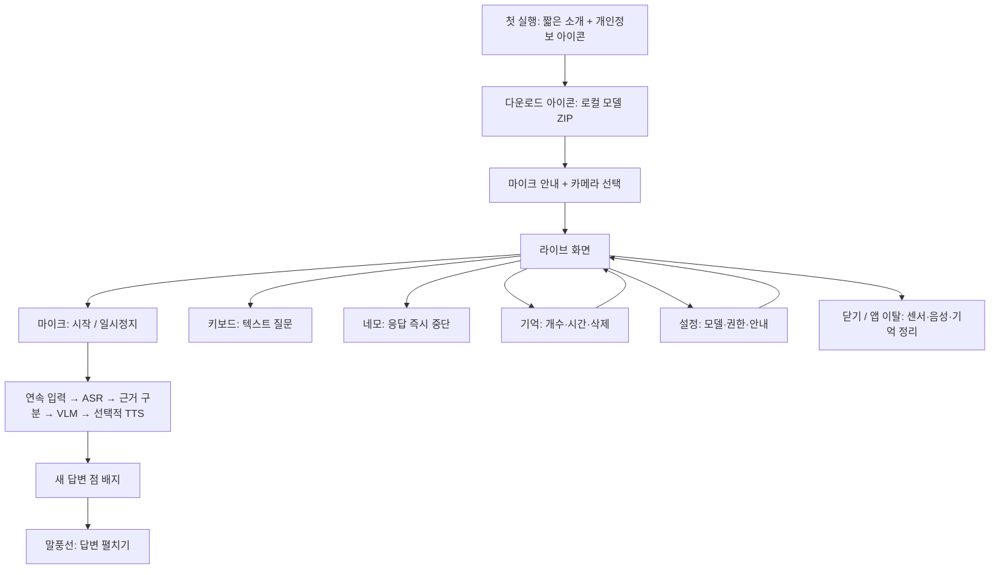

# 곁 · Android Live 워크플로우

2026-10-13, **0.7 아이콘 UI + 세션 기억 + 먼저 알려주기** 기준. 기본 라이브 화면은 아이콘 중심이고, 사용자가 여는 채팅창에는 질문·답변을 말풍선으로 표시한다. 중앙은 원형 파형과 높이가 달라지는 막대이며 실제 음성 재생 중 PCM 크기에만 반응한다. 생각 중·듣기·무음 채팅에서는 정지한다. 카메라는 우측 상단 작은 preview로 표시한다. 기존 취소와 세션 기억 정책은 유지한다.

검증된 MT6989 기기에는 VLM OpenCL을 적용한다. 첫 글자는 빨라졌지만 CPU TTS가 느려 0.6의 실제 음성 시작은 짧은 고정 질문에서도 약11–17초였다. [지연 진단](../reports/android-latency-diagnosis.md) · [채팅/파형 검증](../reports/android-chat-validation.md).

## 화면 원칙

- 이름/테마: **곁 · Live**, 바탕 `#0A121D`, 카드 `#162332`, 민트 `#7EE1C9`.
- 기본 화면에는 카메라와 동작 아이콘만 둔다. 상태는 체크/모래시계/파형/스피커/느낌표 모양으로 표현한다.
- 아이콘을 **길게 누르면 툴팁**. 상태·정보 아이콘을 누르면 상세 설명. 접근성 이름을 각 버튼에 제공한다.
- 켜짐/꺼짐은 색뿐 아니라 사선·재생/일시정지 모양으로 구분한다. 센서 사용 전 카메라가 작동 중인 것처럼 표시하지 않는다.
- 문장은 답변, 사용자가 연 도움말, 오류 상세에서만 표시한다. 기억 설정에는 `1개/2개`, `1분/5분/15분`처럼 짧은 선택값만 남긴다.
- 온보딩 완료 후 중간 홈 화면 없이 바로 라이브로 들어간다. 센서는 자동으로 켜지지 않는다.
- 기존 Java native UI와 직접 그린 24-unit 선형 아이콘을 사용한다. 새 UI 라이브러리/폰트/네트워크 의존성 없음.

## 확정 흐름

## 화면과 아이콘

| 영역 | 구성 | 누르기 / 길게 누르기 |
|---|---|---|
| 상단 | 상태, 도움말 아이콘. 기억/설정에는 짧은 화면 제목 | 상태 상세 / 현재 상태 설명 |
| 라이브 중심 | 원형 음성 파형, 우측 상단 작은 카메라 preview | 센서가 꺼지면 마지막 프레임을 숨김 |
| 종 아이콘 | 조건 설정·중지, 활성 점·완료 체크 배지 | 이번 대화에서 맡긴 부탁 / 동작·대기 설명 |
| 장면 배지 | 기억 아이콘 + 관측 개수 | 기억 탭 / 보관 정책·현재 개수 |
| 보조 동작 | 카메라, 스피커, 키보드, 말풍선 | on/off, 입력창, 답변창 / 동작·현재 상태 |
| 핵심 동작 | 네모, 큰 마이크/일시정지, 닫기 | 즉시 중단, 시작·멈춤, 대화 종료·삭제 |
| 하단 탐색 | 파형, 기억, 설정 | 화면 이동 / 화면 이름 |
| 기억 | on/off 아이콘, 개수/시간 칩, 관측 사진, 시계, 휴지통 | 정책 변경·삭제 / 과거 근거 설명 |
| 설정 | 모델·권한·안내의 짧은 제목과 아이콘 | 모델 가져오기·재시도, OS 권한 설정, 첫 안내·정보 |

질문과 답변은 기본 화면을 차지하지 않는다. 새 답변은 말풍선의 점 배지로 알리고, 확인하면 점을 지운다. 키보드는 마이크와 음성을 끈 무음 채팅을 열고, 말풍선은 현재 음성 설정을 유지한 대화창을 연다. 최대 8개 질문/답변 쌍을 세션 안에서 표시한다. 오른쪽 민트 말풍선은 질문, 왼쪽 남색 말풍선은 답변이다. 텍스트 입력은 300자 상한이다.

답변은 모델이 실제 생성한 부분부터 갱신하고 생성 중 커서를 붙인다. 완성된 답변을 인위적으로 늦춰 보여 주지 않는다. 한글/이모지의 완전한 문자 경계만 표시한다. 음성 합성보다 먼저 텍스트를 읽을 수 있지만 단어별 음성 재생 시점에 맞춘 자막은 아니다. 채팅창의 스피커·중단·닫기·전송 아이콘과 길게 누르기 설명을 제공한다. 무음 질문은 TTS 자체를 생략한다. 음성을 끄는 도중에는 진행 중 응답도 중단한다.

0.7에서는 최근 4개 대화와 최대 4개 관측 요약, 사용자가 종 아이콘으로 맡긴 한 가지 조건을 실제 모델 문맥에 넣는다. 모델 KV는 요청별 초기화하며 일반 대화와 부탁 회상은 이미지 없이도 답한다. 사진 없는 현재 위치는 추측하지 않도록 지시하지만, 기존 spatial 평가의 결정적 유보와 달리 이 비서 경로는 모델 정책에 의존한다. 채팅 기록은 관측/대화 삭제, 기억 끄기, 앱 이탈 또는 세션 종료 때 함께 지운다.

## 상태와 예외

- 준비: 체크. 모델 가져오기 필요: 다운로드. 모델/답변 준비: 모래시계. 듣는 중: 파형. 출력 중: 스피커. 확인 필요: 느낌표.
- 출력 상태는 AudioTrack playback head와 실제로 기록한 sample 수를 비교한다. 음량계도 기록 시점이 아닌 재생 위치에 해당하는 고정 20ms PCM 구간을 사용한다. AudioTrack이 비어도 PLAYING 상태를 유지하는 이유로 출력 배지가 계속 켜져 있지 않게 한다. 물리 스피커 지연 측정값은 아니다.
- 오류는 느낌표와 일시적인 짧은 알림을 사용한다. 느낌표를 누르면 원인/재시도 경로가 보인다. 일반 상태 메시지를 상시 본문으로 표시하지 않는다.
- 모델을 준비하지 않아도 화면을 둘러볼 수 있지만 실제 시작/질문은 거부한다. ZIP 경로·크기·SHA256 검증 후 로드하며 실패 시 재선택/다시 준비를 제공한다.
- 라이브 시작 시 필요한 권한만 요청한다. 카메라 거절 시 마이크만 사용할 수 있고, 마이크 거절 시 텍스트/설정 경로를 제공한다.
- 통화/audio focus 상실은 입력·생성·재생을 멈춘다. 복귀 후 사용자가 다시 시작한다.
- 새 발화/중단은 epoch 증가, PCM 큐와 AudioTrack 비우기, 모델 협력 취소, 늦은 텍스트/PCM 폐기를 수행한다. 마이크 수신은 추론을 기다리지 않는다.

## 기억과 개인정보

- 기본값: 최근 관측 **2개·5분**. `0/1/2개`, `1/5/15분`. 설정만 영구 저장한다.
- 현재 화면: 질문 시점 3초 이내의 캡처. 과거 근거에는 경과 시간과 현재 화면이 아님을 붙인다.
- 보관 끄기는 기존 관측을 삭제하며, 현재 질문의 신선한 화면은 계속 사용할 수 있다. 개별 삭제는 같은 프레임의 현재 참조도 제거한다.
- 만료된 관측은 조회·추론·기억 화면에서 제외한다. 전체 삭제는 관측과 표시된 답변을 제거한다. 요청 간 모델 KV 문맥을 재사용하지 않는다.
- 내부 탭 이동: 센서와 진행 중 응답 정지, 세션 기억 유지. 라이브 탭을 다시 누르는 것만으로 이미 진행 중인 대화를 끊지 않는다.
- 명시적 종료·라이브에서 뒤로 가기·다른 앱/잠금/Activity pause: 관측·답변·열린 대화 창 삭제, 입력/출력 정지. 자동 녹음 재개 없음.
- 추론 임시 파일은 완료/취소 후 제거하고, 강제 종료 잔여물은 다음 실행에 정리한다. 모델은 앱 내에 남는다.
- INTERNET 권한/백업 없음. 장기 기억 DB, 전체 장면 녹화, 상시 물체 추적, 개인 프로필 편집은 제공하지 않는다.

## 검증 경계

Galaxy S, 물리 RAM 12GB 이하, 완전 오프라인이라는 기존 타깃을 유지한다. Qwen 시스템 듀플렉스이며 MiniCPM 네이티브 듀플렉스와 구분한다.

이전 모델 기준선은 [0.2 검증](../reports/android-live-validation.md), 아이콘 UI의 재검증은 [0.3 검증](../reports/android-icon-ui-validation.md)을 따른다. 실제 Android 모델 smoke도 물리 Galaxy S의 음향·열·실시간 속도 합격을 대체하지 않는다.

공식 근거: [Android 툴팁](https://developer.android.com/develop/ui/views/components/tooltips), [런타임 권한](https://developer.android.com/training/permissions/requesting), [audio focus](https://developer.android.com/media/optimize/audio-focus).

## 먼저 알려주기와 기억 (0.7)

1. 종 아이콘에서 “컵이 보이면 알려줘”처럼 화면으로 확인할 조건을 입력한다. 빈 입력은 중요한 장면 변화 알림이다. 시간 예약·외부 앱 실행·음성 부탁 자동 등록은 구현하지 않았다.
2. 라이브와 카메라를 켜면 약15초 간격으로 최신 프레임 하나를 실제 VLM에 보낸다. 대화/음성 재생 중에는 기다리며 사용자가 말하면 관측 생성을 취소한다. 관측 backlog는 만들지 않는다.
3. 첫 장면은 조용히 기억한다. 맡긴 조건은 서로 다른 두 관측에서 연속 확인한 뒤 한 번 알린다. 조건 없는 변화 모드에서는 주요 사물·사람 변화만 알리고45초 cooldown을 둔다.
4. 알림은 말풍선 점 배지·일시적인 알림으로 표시한다. 스피커가 켜져 있으면 같은 짧은 내용을 합성한다. 다시 묻지 않아도 관측/부탁 기억이 다음 질문에 사용된다.
5. 기억 탭에서 부탁·과거 관측·대화 문맥을 확인하고 휴지통으로 삭제한다. 1/5/15분 보관을 공유하며, 기억 끄기·종료·앱 이탈은 전부 지운다. 종의 중지는 관찰만 멈추고 미만료 기억은 유지한다.

조건은 명시적 사용자 입력이다. 관측은 모델이 이미지에서 추출한 요약이며, 사용자가 알려준 사실/부탁 및 과거 관측과 구분해서 모델에 전달한다. 카메라꺼짐·3초 초과 오래된 입력·12초 초과 늦은 결과·취소 epoch·잘못된 JSON은 알림 근거가 되지 않는다. 동작 검증과 Live 성능 수용 여부는 [별도 보고서](../reports/android-proactive-validation.md)에 기록한다.

## 실행 중 정하는 요리 도우미 (0.8)

1. 냄비 아이콘을 눌러 만들 요리·현재 재료·제외 조건을 입력한다. 비워 두고 시작하면 음성이나 채팅으로 정한다. 앱에 기본 메뉴나 레시피를 넣지 않는다.
2. 현재 단계 한 문장과 진행 번호를 표시한다. 완료 체크 또는 “다 했어”로 다음 단계, 뒤로 아이콘으로 이전 단계, 일시정지/재개 아이콘으로 안내를 멈추거나 이어 간다. “어디까지 했지?”는 저장된 현재 단계를 즉시 읽는다.
3. 라이브 마이크와 카메라를 켜면 화면 변화 시 현재 단계에 관한 짧은 질문/팁을 준비한다. 카메라 판단으로 단계를 완료 처리하지 않는다. 카메라 관측 생성은 사용자 입력·음성 출력보다 우선하지 않는다.
4. 요리나 조건을 바꾸려면 냄비 아이콘에서 요청을 수정하고 순서를 다시 잡는다. 진행 중 일반 질문은 기존 모델과 최근 대화 기억을 사용한다. 자유 발화의 모든 조건 변경이 계획에 자동 반영된다고 보장하지 않는다.
5. 시계 아이콘으로 1초~60분 타이머를 설정한다. 남은 시간은 배지, 설명은 툴팁이다. 안내 일시정지 중에도 타이머는 계속된다. 앱을 벗어나면 세션과 타이머가 지워지므로 백그라운드 조리 알람으로 사용하지 않는다.
6. 음성은 설치된 오프라인 한국어 기기 음성을 사용한다. 요리는 해당 음성이 없으면 글로 안내한다. 0.9부터 일반 대화/먼저 알림도 이 음성을 우선 쓰며, 일반 모드에서는 없을 때 Qwen TTS로 대체한다. 자동 이어버드 감지/음소거 정책은 추가하지 않았다.

요리 작업 상태는 최대 400자 요청·8단계로 제한하며 명시적으로 완료한 단계만 완료 기억에 넣는다. 이 작업 상태는 진행 중 세션 끝까지 유지하고, 최근 이미지/대화의 1/5/15분 만료 정책과 구분한다. 기억 끄기·전체 삭제·요리 종료·앱 이탈 시 삭제한다. 모델이 만든 조리 순서의 정확도 및 실제 주방에서의 Live 수용 여부는 [요리 검증](../reports/android-cooking-validation.md)에 별도 기록한다.

0.9의 선택적 450M 관찰 모델은 현재 단계에 명시된 지원 사물만 확인한다. 관련 사물이 보이면 기존 단계의 조건부 안내를 다시 보여 주며, 모르는 사물이나 불확실한 출력에는 침묵한다. 메뉴를 미리 정하지 않으며 카메라로 완료·익힘을 판단하지 않는다. 첫 실행 모델 준비에 GPU 예열이 포함된다. 조리법 검토에서 확인된 오류가 한 번의 재생성 뒤에도 남으면 잘못된 순서를 읽지 않고 확인을 요청한다. 상세 제한과 실측은 [0.9 보고서](../reports/android-realtime-model-study.md)에 기록한다.
